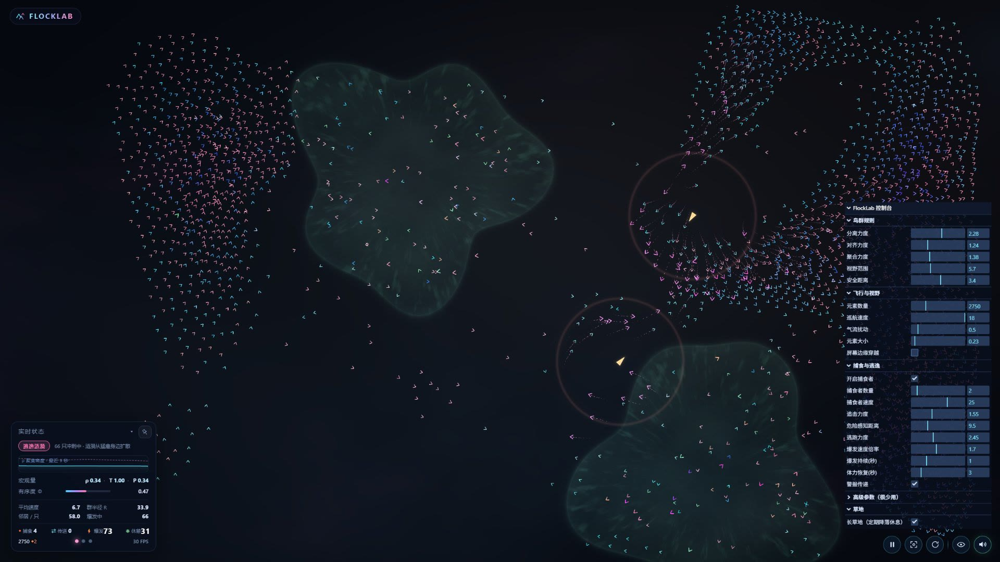

# FlockLab



俯视二维平面上的鸟群 Boids 涌现模拟：**小元素是鸟群，大元素是大型猛禽**。800 个箭头个体只遵循「分离 / 对齐 / 聚合」三条局部规则，配合捕食者、逃命爆发（带拖尾）、草地休憩、程序化音效与随聚集度变化的生成式音乐，观察群体行为如何自发形成——没有任何一只鸟知道全局队形。

- 在线体验：<https://show.ewing.top/flocklab/>
- 安装为应用：用 Chrome / Edge 打开，等**地址栏右侧出现安装图标**时点一下，即可装成本机应用——独立窗口、无地址栏，装好之后**断网也能打开**
- 开源许可：MIT（见 [`LICENSE`](./LICENSE)）
- 模块化实现：`index.html` + `css/` + `js/` + `assets/`，无构建步骤

## 特性

- **纯二维**：正交相机，活动范围就是**屏幕可视范围**（半高 `BOUND × 1.02`，宽度按显示器比例展开），一直飞到画面边缘才穿墙，不提供范围滑块。
- **GPU 渲染**：`InstancedBufferGeometry` + 原生 GLSL，箭头朝向与形状全部在着色器里完成，CPU 只写颜色与尺寸。1 万只只是一次 4 万顶点的实例化绘制，提交耗时约 0.5ms，GPU 侧余量很大。
- **视野内全部邻居（原始 Boids）**：每只鸟对**视野半径内能看到的每一个同伴**都施加对齐 / 聚合 / 分离，没有「只看最近几只」的截断——这是最原始的 Reynolds 涌现规则。（v31–v40 曾改成「只注意最近 7 只」的拓扑邻域，Ballerini 2008 对椋鸟的实测结论；但在这个密度下那 7 只常常全在自己格子里，聚合质心被钉在格心、群体被拽成一个个方块，还会「聚→炸→再聚」反复横跳，v41 已移除。）代价是配对量随密度平方级上升：默认 800 只密集成团时每只鸟约有 100–250 个邻居，所以保留一个**每帧最多扫多少个候选**的安全阀（`sepCap` = 130/110/90 按数量分档，正常密度下远大于真实邻居数，等于没有上限）。
- **1 万只上限与吃满硬件**：元素上限 **10000**（默认仍是 800；v31 曾放开到 5 万，v38 起收回 1 万以匹配实际使用场景）。为让大数量真的跑得动，热路径做了三件事：① 空间哈希从 `Map<字符串键, 数组>` 换成**二维计数排序网格**（计数 → 前缀和 → 回填，纯 TypedArray、一次分配长期复用，重建仅约 1ms，不再每帧新建上千个桶数组触发 GC）；② 邻域只查 9 个格（俯视二维，原来 27 次查表有 24 次必然落空）并按由近到远取前 7 只；③ 逐只 `THREE.Color.setHSL` 换成 **32×16 预计算调色表**，渲染朝向的低通也并进同一趟循环，颜色段 8ms → 1ms 左右、实例上传 4.6ms → 1ms 左右。CPU 负责物理与实例数据、GPU 负责全部箭头形状与朝向，二者都不再被无谓的分配拖住。
- **速度上限**：每只鸟的速度上限直接取当前状态的目标值——爆发 > 受惊 > 巡航节奏（巡航速度的 78%），起爆即提速、威胁解除即收速，不做额外的加速度积分。
- **个体随机性**：每只鸟有自己固定的速度系数（0.86–1.14）和一条缓慢漂移的私人游走航向；邻居越多，游走被群体「稳住」得越强。捕食者也有个体速度系数和持续摆尾的航向漂移（追击时幅度小、冷却巡游时幅度大）。这些都是局部量，不改变三条规则，群体结构仍是涌现出来的，只是不再像弹珠一样整齐。
- **墙视为不存在（穿墙）**：鸟和猛禽越过边界后从**对侧同高度**继续出现（右边飞出 → 左边界同 y 处进来），速度方向不变，等价于把场地当成环面（torus）。没有概率、没有弹性反射、没有随机散射、也没有贴边急转掉头——那些都等于把墙挪进场内侧。画面里不再画矩形边框，但活动范围仍作为**显示范围**存在。**「屏幕边缘穿越」默认关闭**：墙是实体，鸟和猛禽在离边缘 8 个单位内就会得到一个指向场内的推力，**提前拐开而不是贴着墙蹭**（越贴越强、只改方向不瞬移），真撞上去才反转那个方向的速度分量（保留 92% 速率）。想要「墙不存在」就在面板里打开它。鼠标捕食者走同一套规则（手划出窗口边缘时它会从对侧飞回来）。**注意：v38–v39 的写法是「关于场地中心对称」（右边飞出 → 左边进、同时 y 取反），它会把跨边界的一坨鸟撕成两半镜像**——已经穿过去的一半在 `-y`、还没穿的一半在 `+y`，两半相距 `2y` 且互不可见，于是每跨一次边界群体就碎一回（实测 25 秒内 800 只累计穿墙 1500 次，群体从 1 坨散成 6–8 坨）。v40 改回纯平移：穿过去的那半只是接着往前飞，队形顺序不变，鸟群能完整地「穿过去再聚回来」。
- **鼠标就是捕食者（趣味玩法）**：在画面上**双击左键**，光标立刻变成一只由人驾驶的猛禽——位置完全跟着手走（**没有速度上限**，只做 45ms 的指数追赶以免一帧跳过去），**箭头朝向 = 光标移动方向**；移出窗口再回来它仍是捕食者；**点一下右键**恢复成普通箭头。它是真实参与仿真的捕食者：鸟群会照常预测、传递警报、逃逸爆发，划过时会留下一串捕杀特效与拖尾，警戒圈跟着光标走；体色更亮的金橙、尺寸再大 12%，和 AI 猛禽一眼分开。期间**点击、拖拽平移、滚轮缩放、点按钮都照常可用**（只把画布上的系统光标藏起来，UI 面板上仍是正常指针）。实现上它独占捕食者数组的最后一个槽位（索引 = 当前 AI 数量），不占 GUI 的「捕食者数量」额度，也不受「开启捕食者」开关影响；冷却单独设成 90ms（人控制时划过就吃，但不会一下清空全场，被吃的个体 1 秒后照常重生）。双击是自己判定的「两次干净点击都落在画布上」：直接监听 `dblclick` 会在双击状态卡标题时误触发（第一次点击把卡片折叠、卡片移位，第二次点击就落到下面的画布上了）。
- **捕食与逃逸**：捕食者是锐角（等腰）三角形——腰长 = 元素尺寸的 1.4 倍、底 = 0.7 倍，再整体 ×2；带碰撞体积，接触即算捕获（用「上一帧→当前帧」线段做扫掠判定，高速追击不会穿模）。**体色就是状态指示**：狩猎/待命是深橙，吃到东西后立刻渐变（0.32s）成浅橙黄表示「吃饱了，暂时不追」，冷却最后 1 秒再渐变回深橙。**警戒圈永远显示**：饱食/冷却期是稳定可见的**暗红圈**，捕食阶段是**高饱和亮红圈**，呼吸只做 ±12% 的轻微起伏——不会因为吃饱就把圈藏起来。吃饱后的冷却期不再随机改航向，而是选一个场地内部（内缩 38%）的巡逻点滑过去，到点或 6–11 秒后再换；巡逻点不会落在草地上，而且**快贴上草地时会有意识地绕开**（不是硬性禁止穿行，真擦进去也允许，1–2 秒内会被推出来；追逐时不避让，免得把猎物赶到草地上就追不下去）。鸟群会预测威胁点、传递警报、整群绕开，危险时短时爆发冲刺（体力耗尽必须恢复）。
- **草地与休憩**：场地里随机长出 2–3 片「云朵状」草地（极坐标谐波 `r(θ)=R(1+a₁sin3θ+b₁ + a₂sin5θ+b₂)`，在着色器里直接求值，缩放不糊），总面积占屏幕 **0.15**，允许压在边界上（被切掉的部分会按实测面积补回来，所以场内可见面积仍是 0.15）。草地上有值噪声做的明暗斑块、沿角向切出的草叶条纹和边缘微动，近看像真的草丛。
  每只鸟每隔约 20–53 秒必须去一次草地：挑一片最近、没满的飞过去（赶路时按巡航速度直飞，靠近后减速），**只有「到点并且几乎不动」才算真的在休息**——还在路上的一律不算。停稳后只要没有危险就一直待着，**最长 60 秒（28–60 秒，逐只错开）**；被捕食者惊到会按「离猛禽多远」给 40–560ms 的反应延迟后错峰飞走，没停稳或没待够 5 秒的隔几秒会再来。停稳的鸟换成苔绿色，和飞行中的青蓝—紫一眼分开。草地上有轻微的**降落 / 起飞音效**（低频「嗒」+ 收翅气流 / 一小段向上的扑翅声）。
  草地上的个体会保持约 1.5 个单位的间距（落点按「离邻居最远」挑）。**落地时若太挤，只把目标点改成身边 0.4–0.8 单位内的空位，由下一帧的速度积分平滑走过去，绝不直接改写位置**——早期版本在这里直接赋值 `pos`，采样点可能落在草地另一头，看起来就是一次瞬移。站定朝向也固定为**落地瞬间的飞行方向**（用低通后的渲染速度求角），箭头不会突然转过去。用户明确允许「干脆不调整方向」，这里选择保留方向但让它完全连续。
  有新鸟要落下时，已经休息 5–60 秒的老住客会以 10% 概率往旁边挪半步（每只最多 2 次）：只登记一个 0–4 秒内的随机起身时刻，不立刻 unsettle，于是一批老住客不会在同一帧齐刷刷动起来。
  **草地有容鸟量限制**（每片 `max(14, 面积/6.6)`），满了会排队，而且排队的鸟有权请走别人：等 5 秒后可以**礼貌请走「已经休息满 5 秒」的老住客**（优先休得最久的那位）；等 10 秒仍进不去就**变红强行驱赶、争夺地盘**（此时连刚坐下不久的也请走）。被请走的按已休时长重排下次休息（休满 5 秒算休成、20–53 秒后再来；没休够 5 秒则 5–21 秒就回来），并有 **12 秒保护期**防止两只鸟来回互赶；争斗红在抢到位子坐下 **2.5 秒**后自动褪去，所以看到的是「刚争夺成功」的红鸟而不是全场红。这样每只鸟最终都休息得到，不会出现「老实鸟永远排不上」。**关掉草地时休息逻辑一并关闭**（排队、争斗态同时清掉，不会留下红鸟在争夺一块不存在的草地）。
  掠过草地的鸟即使还没到休息时间，也有 5%–13%（按个体浮动）概率顺势减速就地落下。**不休息的鸟会主动绕开草地**：靠近边缘时得到一个「法向推开 + 沿运动方向的切向」的力，所以是贴着草地边缘滑过去，而不是撞上去弹开。
  **作息随机性**：每只鸟出生时抽一个固定的「作息相位」（0–1），之后每次重排「下次出发」「起身离场」「满了重试」「受惊重试」「换位起步」都叠加它；掠过落地的概率也按相位浮动（5%–13%）。再加一层**软错峰**：每帧最多放行 2 只鸟出发去草地、1 只鸟站定，超出的只把预约顺延 0.25–2 秒，不取消需求也不减少总次数，于是「一群鸟同时飞去 / 同时落地」被摊成均匀细流。实测单帧同时出发从 21 只降到 2 只，同帧站定竞态消失后草上最小间距从 0.66 回到 1.29。
- **反应延迟**：进入危险感知圈只是「看到」，还要累积够反应时间才会爆发——贴身约 45ms、感知圈边缘约 260ms（按距离平方过渡），再乘个体反应系数 0.78–1.32。所以爆发像一圈涟漪从捕食者身边向外扩散，而不是整群同时亮起。脱离感知圈会清零重来。
- **群体归拢（长程）**：感知半径只有 7 个单位，两坨鸟一旦拉开到超过这个距离就永久互不相见——强分离把群体压成许多个「结晶小团」，彼此既不吸引也不排斥，结果就是满屏一小坨一小坨、群体半径铺满整屏。真实椋鸟群是整群一起转向的，归拢本来就不只发生在 7 个单位以内，所以补了一条**只对「离群体质心超过 18 个单位」的个体生效的弱长程吸引**（力度系数 14，远小于转向上限 22，只做方向上的缓慢修正）：小团会被慢慢拉回主群，质心附近的个体完全不受力，队形仍由三条规则决定。半径随数量开方放大（`18 × √(n/800)`，夹在 12–60），否则 3000 只会被压成和 800 只一样大的实心球。质心与群体半径都按**最小映像**算，跨边界飞时不会被带偏。
- **密度配色**：飞行个体的色相由**局部密度**（3×3 格里的活跃个体数，与「注意力只取 7 只」解耦）决定，稀疏处青蓝、密集处紫红，速度只影响亮度；停在草地上换成苔绿，争斗变红，爆发时在自身色相上烧向洋红。**这条曾经是坏的**：渲染读的是 `neighbors[i] / 24`，而 `neighbors` 从 v31 起就是「注意力邻居数」、最多 7 只，于是色相上限只能到 `0.52 + 0.29×0.4 ≈ 0.64`（蓝绿之间），再怎么抱团也到不了紫色。v40 改用 `localDen`，并按新的群体尺度把归一化基准从 70 调到 110，让默认 800 只的分位落在 p50 ≈ 0.5 / p95 ≈ 0.95，青蓝→紫整条色阶铺得开。
- **爆发配色**：爆发不是把个体染成黄色，而是在自身色相上烧向洋红（即群体渐变最末端的紫红端），亮度与尺寸在起爆瞬间冲高、随后回落，全段保持同一身份色，避免固定频率频闪。
- **爆发只有一种动机**：只有被捕食者逼近时才会短时冲刺逃命；掉队不会触发爆发，靠常规转向力慢慢归队。体力耗尽后必须恢复（默认 0.8s / 1.35× / 5s 恢复）。
- **加速尾迹是独立粒子（像飞机尾迹）**：鸟和猛禽共用一套 **4800 槽位的环形粒子池**，每个粒子在生成瞬间**冻结世界坐标与航向**，之后不随实体移动，所以转弯时自然连成一条弧线；粒子按自己的寿命在着色器里逐渐淡出、缩短、变窄，CPU 不逐帧遍历。**从实体尾部发射**——粒子的亮端正好贴在猛禽三角形的底边（或鸟的尾角连线中点），整体拖在后方，不会盖住本体。鸟按「速度超出巡航节奏」、猛禽按「加速度尖峰」判定加速，都先过一道「快起慢落」包络再按个体节流撒点，其余逻辑完全共用。鸟的尾迹刻意做得细、密、淡（单颗 0.30 长、0.24 倍身宽、13–24ms 一颗），猛禽更长更亮——同一时刻常有上百只一起加速，太抢就看不清主体了。
- **尾迹不会被瞬移拉长**：穿墙、被吃掉、重新出生、改数量都会把**发射包络**清零（已生成的粒子留在原地是对的，那是历史航迹），所以落点不会凭空接上一段。
- **进食冷却巡游**：捕食成功后进入冷却，期间不再追击，只以四成速度随机巡游保存体力；冷却时长最多可调到 60 秒。
- **延迟重生**：被吃掉的个体隐藏 1 秒后再出生，重生点从 32 个候选位置里挑离所有捕食者最远、且离边界留有余量的位置。
- **出生有动画，不是凭空出现**：每只鸟都带一个「涌出」进度（`aGrow`，GPU 实例属性），由顶点着色器做三段事——**先亮成一个微小的点（前 16%）→ 由 12% 尺寸展开到 100%，带轻微过冲 → 起手快速自转到成形后归零**，同时按 `smoothstep` 淡入，颜色在刚冒头时整体偏亮（像带着光长出来）。重生时原地还会散出 5 道极淡的绿丝（复用尾迹粒子池，不额外开一套），所以看到的是「从一点光里长出来」而不是「啪一下变出来」。**开局与改数量也走这条路径**：新个体按 0~900ms 随机错峰，整群是一层层涌出来而不是一次全亮。注意它和「新生亮绿」是两件事——亮绿（3.2s 渐变回常态）只在**被吃掉后重生**时出现，否则开局 800 只全部闪绿会变成一片绿光。
- **事件音效**：共六类——加速逃逸 / 被吃掉 / 新生 / 草地降落 / 草地起飞 / **捕食者加速**，均由 Web Audio 实时合成。加速音是**一串振翅颗粒**：3 记 14–22ms 的高频「扑棱」脉冲（2.6–4.4kHz）+ 一记 1.5→3kHz 的上扬 sine 哨音，整组串 700Hz 高通切掉低频浑浊，声像随机；严格限流（间隔 55ms、每秒最多 12 组），密集爆发时是成串清脆的振翅而不是发闷的气流。
  **草地落地 / 起飞是「轻快」的**：落地是低频「嗒」+ 收翅气流 + 一声落在五声音阶上的下滑小亮音（`land()`）；起飞是扑翅噪声 + 两声上行小音（第二声升一个音级，`takeoff()`），比落地更亮，听感像鸟从草里窜起来抖了一下翅膀。
  **捕食者加速是另一套音色**（`predDash()`）：低频气流「呼——」（带通 720→170Hz 扫频）+ 一声锯齿波下行嘶鸣，和鸟的高频振翅颗粒完全区分得开。只在加速度包络**由低冲高**越过阈值时触发（边沿触发，不是每帧），每只捕食者 400ms 内最多一次——扑击起步和急转会响，匀速巡航不响。
  **静音是一道硬闸门**：所有发声路径（含音乐）最终只经过 `master → destination` 这一个出口，静音时增益归零、断开出口、`AudioContext.suspend()` 三件事同时做；静音偏好写进 `localStorage`，**刷新后仍然静音**（旧版的坑：`enable()` 里先 `await ctx.resume()`，无手势被拒时整段中断，静音偏好没来得及应用，master 还连着 destination——用户随便点一下触发 resume，声音就漏出来了）；切到后台 / 页面隐藏时主动断开并挂起，调度器也停掉，不在后台空转排音符。
- **生成式音乐**：六层音景。前四层由**聚集度**驱动——① 低频 drone（A2 110Hz 基音 + 五度，95Hz 高通切掉隆隆声，0.07Hz 缓慢音量摆动，避免一直「嗡嗡」）② 和声 pad（开放五度 → 小三和弦 → 加九度音簇，每两小节换一次，带滞回不会来回跳）③ 低频 pulse（八分音符按聚集度稀疏化，散开时几乎不出声）④ 高音 shimmer（只有抱团到一定程度才出现）。后两层刻意压得很轻，**大部分时间几乎不存在、细听才辨得出**：⑤ **bass**——常驻 A1 55Hz 正弦 + 极轻五度，经 130Hz 低通磨圆，由 0.043Hz「呼吸」与「浮现门」两级控制，平均每二十来秒慢慢浮上来十秒再沉下去（电平只有主层 1/3）；⑥ **orbit 盘旋声**——两个微失谐低频正弦 + 一丝 380Hz 窄带气流，经 `StereoPanner` 随猛禽在画面里的位置极慢左右游走（0.31rad/s 环绕），音量随「饥饿度」与「离群体远近」变化，捕食阶段逼近时最容易听到、饱食远巡时几乎融进背景。音高全部锁在 A 小调五声音阶里，程序化合成、无采样文件；爆发比例高时和声整体下沉（最多一个半音）。音乐与事件音共用**右下角**同一个声音开关（静音 / 开声），**没有音量滑块**：音乐与音效都固定跑满刻度（1.5 增益，总线另有 0.38 的余量），要小就整个静音。
- **进入自动收起**：页面载入先完整显示所有界面约 1 秒，随后**带约 0.45 秒的淡出动画自动收起**——等同自动替你点一次「隐藏所有界面」，画面里只留小眼睛（闲置 3 秒后连眼睛也淡出）。收起后**任意操作只让小眼睛显现**，点小眼睛才展开完整界面（与手动隐藏完全是同一套逻辑）；「关于」弹窗开着时自动收起会顺延，不会从弹窗底下抽走界面。**每次打开 / 刷新都会重演一遍**。
- **界面克制**：左上角只留 LOGO（点击打开「关于」），**所有控制按钮与控制台统一收在右下角**，顺序为「暂停 → 重置视角 → 重新初始化 ｜ 隐藏界面 → 声音」——左三件改变模拟状态、右两件只改变呈现方式，中间以细分隔线分开，全部带悬浮说明；右上角完全留白。所有卡片可折叠，可一键隐藏全部 UI（收起与展开都带淡出动画）；光标与眼睛图标闲置 3 秒自动淡出，晃动鼠标或按键即恢复。
- **手机 / 平板适配**：断点只用宽度与高度，不分设备类型。≤900px 走平板档；≤620px（竖屏手机）状态卡抬到按钮行上方（否则和右下角按钮正面重叠）、控制台变成贴底的整宽抽屉（底色做实，不再和底下的状态卡糊在一起）；高度 <430px（横屏手机）自动收掉迷你曲线与四宫格，状态卡只剩状态徽标 + 宏观量 + 事件行。所有贴边元素都吃 `env(safe-area-inset-*)`，刘海机与手势条不会盖住按钮；可点区域只放大不缩小（触屏 ≥40px）。画布本身支持单指拖拽平移、双指捏合缩放、双击重置视角。
- **状态卡有看点**：左下角卡片不再只是九个静态数字，而是「主导状态徽标（自由巡航 / 同向齐飞 / 紧密成团 / 群体警戒 / 逃逸涟漪 / 草地休憩，会随群体自动变色）+ ρ 与音乐聚集度的 9 秒双曲线 + Vicsek 有序度 Φ 进度条 + 平均速度 / 群半径 / 邻居数 / 爆发中四宫格 + 捕食（累计）· 传送 / 爆发 / 休憩（**近 1 秒的发生次数**，10 个 100ms 滚动桶）」。卡片右上角有**图钉**：钉住后「隐藏所有界面」不会把它一起藏掉，不钉住就随其他 UI 一起隐藏，选择会记住。
- **动态背景**：四层都不参与仿真、也不抢主体（线性空间亮度 0.003–0.02，转 sRGB 后仍是近黑的深蓝）。① **星云**：全屏 quad 上两层不同尺度与方向的 fbm 噪声缓慢漂移（冷蓝一层、偏紫一层），再叠 40 秒级的整体呼吸；② **光带**：一层沿对角线缓慢漂移的低频宽条（v41 去掉了原来那些会闪烁的星点，闪烁在静态画面里很脏）；③ **地貌剪影**：半夜俯瞰一样的地面——一片片淡绿色的草地 / 田、一条蜿蜒的河（暗河岸 + 水面 + 断续反光）、两三处沿村道排开的小村子（统一的屋脊线，偶尔一点暖色窗灯）。全部用 canvas 一次性画成纹理再加法叠上去，每帧只剩两次纹理采样，比在片元着色器里堆噪声便宜得多；**v42 去掉了原来的「山坡」横带**（那几条脊线在静态画面里更像划痕，不像坡）。**地貌会主动避开草地**：在着色器里按世界坐标判断像素是否落在某片草地内，是就把地貌抹掉（轮廓用和草地完全相同的极坐标谐波，边界再留 8% 余量），所以河与村庄是绕开草地、而不是从草上穿过去——判定用世界坐标，拖拽平移、缩放都永远对得上，不需要重画纹理；④ **浮尘**：380 颗点精灵在世界坐标里缓慢上浮 + 横向游走 + 呼吸，漂移全在顶点着色器里算（原来 `uTime` 从没被更新，那层浮尘其实一直是死的）。背景随相机缩放平移一起走，不会露边；地貌另有 22% 的视差（远景比鸟群移动得慢）。
- **可以装成本机应用（PWA）**：`manifest.json` + `sw.js` + 一整套图标（48/71/96/128/150/192/256/384/512 + maskable 192/512 + 180 + `favicon.ico` + SVG）。Chrome 与 Edge 判定「可安装」后**由浏览器自己在地址栏右侧提示安装**（应用不自己弹按钮，也不拦 `beforeinstallprompt`）；装好后是独立窗口、没有地址栏。Service Worker 把整个壳（含 CDN 上的 three.js 与 lil-gui）一起缓存，**断网也能冷启动**：静态资源走「先给缓存、后台更新」，CDN 依赖（URL 里带版本号、内容不会变）走「缓存优先」，导航请求走「网络优先、断了退回缓存里的 index.html」。调试时加 `?nosw=1` 可跳过注册。
- **参数持久化**：调过的参数写入 `localStorage`（当前键 `flocklab.params.v6`），刷新页面继续沿用；只有点「重新初始化」才恢复出厂默认值。**出厂默认值变更时会提升存档版本号**，让老用户也能拿到新默认值；状态卡的图钉状态单独存在 `flocklab.hud.pinned`，不受参数版本影响。
- **打开即看**：页面不再有进入弹窗，直接开始模拟；声音仍是首次操作时自动解锁（浏览器自动播放策略）。

## 怎样看出这是「涌现」（观察建议）

涌现的意思是：整体有秩序，但没有谁在指挥。下面几条都能在页面上亲手验证，比读代码直观：

1. **只改一条局部权重**：先关掉猛禽，把「聚合力度」从 1.16 拉到 0 → 鸟群散成均匀一片；再拉到 3 以上 → 迅速收成几个紧团。你没动过任何「队形」参数，全局形态却变了，因为每只鸟只是更想靠近身边的邻居。
2. **只盯一只鸟**：按暂停逐帧看，它永远只对最近的 7 个邻居起反应，从没「照着队形飞」。把「对齐力度」调 0 再调回 1.8，会看到队伍从散乱重新变得同向——这是局部对齐在整群上的放大。
3. **等一次捕食**：猛禽逼近时爆发不是整群同时亮，而是一圈从它身边向外扩散的涟漪。原因是反应延迟随距离从 45ms 增长到 260ms；把「警报传递」关掉，涟漪会明显变钝。
4. **看警戒圈和体色**：刚吃饱是暗红圈 + 浅橙黄身体，饿了转成亮红圈 + 深橙身体。两个独立通道同步表达同一个内部状态，这是「状态可读」而不是「装饰」。
5. **看草地的轮换**：落地变苔绿、彼此留间距；停稳 ≥5s 才算休息，被打断要重新计时；新鸟落下时老住客偶尔换位。这是把「个体有各自需求」加进群体后自发出现的排队现象。
6. **对比两个极端**：把数量调到 10，几乎看不出群体；调到 10000，会看到密度波和裂口（数量很大时单帧仿真耗时约 6–10ms，属主线程物理计算，绘制仍不到 1ms）。同一个规则集在不同规模下出现不同宏观形态，是涌现的典型特征。
7. **用状态卡量化**：`ρ`（聚集密度）、`T ∝ v²`、`P = ρT` 借统计物理口径描述群体；再看**有序度 Φ**——散乱时接近 0、整群同向时接近 1，配合 9 秒曲线能亲眼看到相变。把「对齐力度」从 0 拉到 1.8，Φ 会明显爬升，这就是局部规则在整群上的放大。调参数时盯这些数，能把「看起来更整齐」变成可比较的量。
8. **自己下场赶一次群**：双击画面把光标变成捕食者，慢慢推进会看到鸟群像被真猛禽驱赶一样整片绕开、边缘先炸开一圈洋红爆发；快速横扫则是一串捕杀闪光。右键退出后对照 AI 猛禽的行为，能直观看出「只要有一个移动的威胁源，群体就会自己组织出回避」，不需要任何全局指令。

## 更多有趣机制与可行性

以下多数**尚未加入**（标注「已加入」的除外），按「是否符合事实 / 是否是成熟算法 / 落地代价」筛过，供后续迭代挑选。前几条只需在现有局部力上加权，不破坏三条规则：

| 机制 | 事实 / 算法依据 | 可行性 | 落地代价 |
| --- | --- | --- | --- |
| 少数「知情个体」带领整群 | Couzin et al., *Nature* 2005：极少数有方向偏好的个体即可引导群体，冲突偏好会被群体平均掉 | **高** | 给 1–5% 个体加一个恒定航向偏好，不改三力；可观察「信息比例」阈值 |
| Lévy 飞行搜索（捕食者找猎物） | Viswanathan et al., *Nature* 1999：稀疏目标下幂律步长比布朗运动更高效 | **高** | 把冷却巡游的巡逻点改成按幂律取步长；现成巡逻框架可直接复用 |
| 视锥与视觉遮挡 | 鸟类有后方盲区，只能响应前方约 ±135° 邻居 | **高** | 邻居力乘一个朝向权重；代价是队形会出现真实鸟群的细长裂口，需重调默认参数 |
| **Vicsek 有序参量与相变（已加入）** | Vicsek et al., *PRL* 1995：`φ = \|Σvᵢ\| / Σ\|vᵢ\|`，噪声/密度跨阈值发生有序—无序相变 | **已落地** | 状态卡已显示 Φ 进度条与数值（飞行个体方向单位化后求模），并参与主导状态判断 |
| 自私羊群 / 边缘效应 | Hamilton 1971：个体往群体中心挤以降低被捕食风险，边缘更危险 | 中高 | 逃跑力改为「向局部质心 + 远离低密度侧」，需要一份密度梯度 |
| 混淆效应与稀释效应 | 群体越大，捕食者锁定单一目标越难，个体风险被稀释 | 中高 | 让锁定成功率随局部密度下降，或追击航向按密度加抖动 |
| 警报波前速度拟合 | 逃逸波在鸟群/鱼群中的传播实测（*Proc. R. Soc. B* 等） | 中 | 记录每只鸟起爆时刻拟合波速，用来校验现在的 45→260ms 延迟是否接近真实 |
| 能量预算 / 最优巡航速度 | Pennycuick 飞行力学：存在最小功率速度 Vmp 与最大航程速度 Vmr | 中 | 给体力项加「巡航速度—能耗」收益函数，并与草地休憩联动，形成真实的作息循环 |
| Curl noise 湍流风场 | Kraichnan 谱 / 无散度噪声场，比白噪声更有空间结构 | 中高 | 把现有 `flow` 随机流场换成 curl noise；CPU 代价小，视觉上会出现成片的涡旋 |
| 群体决策的法定人数（quorum） | Conradt & Roper：达到某比例个体同意才整体转向，避免少数误导 | 中 | alignment 改成带阈值的加权投票，会出现「犹豫—突然集体转向」 |
| Barnes–Hut / 多分辨率格子 | 把邻居查询从 O(n·k) 降到 O(n log n) | 低 | 视野内全部邻居都算，单帧配对量随密度平方级上升。**多核（Web Worker）已落地**：2000 只真实墙钟 1.1ms、单核 3ms。再往上走真正的瓶颈变成「每帧把数组复制给每个 worker」的带宽与配对量本身，下一步该上 GPGPU，而不是更细的树结构 |

## 参数默认值

| 分组 | 参数 | 默认 | 说明 |
| --- | --- | --- | --- |
| 鸟群规则 | 分离力度 | 2.3 | 贴太近时推开的力度 |
| | 对齐力度 | **1.8** | 与邻居同向的倾向 |
| | 聚合力度 | 1.16 | 向邻居质心靠拢的倾向 |
| | 视野范围 | **7** | 能感知到多远的同伴 |
| | 安全距离 | 1.9 | 小于该距离才开始互躲 |
| 飞行与视野 | 元素数量 | **800** | **10 – 10000** |
| | 巡航速度 | **15** | 平时速度上限 |
| | 气流扰动 | 2.05 | 随机流场强度 |
| | 元素大小 | 0.25 | 仅影响外观；捕食者尺寸按它推导 |
| 捕食与逃逸 | 开启捕食者 | 开 | |
| | 捕食者数量 | 1 | 1 – 10 |
| | 捕食者速度 | **25** | 2 – 36 |
| | 追击力度 | 1.55 | 转向追击的强度 |
| | 危险感知距离 | 9.5 | 猎物开始察觉的距离，也是警戒圈半径 |
| | 逃跑力度 | 2.45 | 个体与整群的逃逸强度 |
| | 爆发速度倍率 | 1.7 | 爆发期速度 = 巡航 × 该值 |
| | 爆发持续(秒) | 1.0 | |
| | 体力恢复(秒) | 3 | 恢复满才能再次爆发 |
| | 警报传递 | 开 | 受惊方向传给邻居 |
| 高级参数 | 最低速度 | 0.5 | |
| | 预判系数 | 0.6 | 逃跑时朝捕食者未来位置躲 |
| | 锁定目标(秒) | 1 | 捕食者专注同一目标的时长 |
| | 进食冷却(秒) | 8 | 0.3 – 60，冷却期只巡游、警戒圈转暗色 |
| 草地 | 长草地 | 开 | 关掉后草地隐藏，正在休息的鸟立刻起飞，排队 / 争斗态一并清零（不会留下红鸟） |
| 边界 | 屏幕边缘穿越 | **关** | 关=实体墙（离边缘 8 单位就提前拐开，撞上反弹、速度损失 8%）；开=墙不存在，从对侧同高度飞回来 |

## 运行

```bash
# 任意静态服务器即可，例如：
python -m http.server 8123
# 打开 http://127.0.0.1:8123/index.html
```

必须经 HTTP 打开：页面用 ES module 加载 `js/main.js`，`file://` 下会被 CORS 拦住。`three` 与 `lil-gui` 从 CDN 加载（jsDelivr，失败自动回退 unpkg），首次打开需要联网。

## 部署

站点目录部署，无容器常驻、无构建。**拆分后必须上传整个目录，只传 `index.html` 会缺 CSS/JS/SVG**。用 tar 打包后由一次性容器解到站点目录并修正属主（1Panel 站点目录属主为 33:33）：

```bash
# 本地（sw.js / manifest / 图标必须一起传，否则装成应用与离线都会失效）
tar -czf /tmp/flocklab.tgz index.html css js assets sw.js manifest.json README.md DEVELOPMENT.md
scp /tmp/flocklab.tgz <host>:/tmp/

# 服务器（不清空目录，同名覆盖，旧版 index.html 会被新的覆盖）
docker run --rm \
  -v /opt/1panel/www/sites/show.ewing.top/index/flocklab:/target \
  -v /tmp:/src postgres:18.6-alpine \
  sh -c "tar -xzf /src/flocklab.tgz -C /target && chown -R 33:33 /target"
```

部署后验「服务出来的字节」而不是只看文件拷过去：

```bash
curl -s -o /dev/null -m 15 --noproxy '*' -w "HTTP %{http_code} ip=%{remote_ip}\n" https://show.ewing.top/flocklab/
curl -s -o /dev/null -m 15 --noproxy '*' -w "HTTP %{http_code}\n" https://show.ewing.top/flocklab/js/main.js
```

## 目录结构

```
flocklab/
├── index.html          # 页面骨架、图标按钮、关于弹窗、SW 注册
├── sw.js               # Service Worker（离线壳 + CDN 依赖缓存）
├── manifest.json# PWA 清单：名称、图标、standalone、主题色
├── css/style.css       # 全部界面样式（含隐藏动画、右下角按钮 / 控制台定位）
├── js/main.js          # 仿真主循环、GLSL、GUI、调试接口
├── js/forces.js        # 邻域受力（全项目最热的一段，单核与多核共用同一实现）
├── js/sim-worker.js    # 多核用的 Worker：只调 forces.js 算自己那段区间
├── js/audio.js         # Web Audio 事件音与六层生成式音乐
├── js/grass.js         # 草地几何、面积校准与着色（休憩调度在 main.js）
├── js/backdrop.js      # 背景地貌（草地斑 / 河流 / 村庄剪影）与漂移云层
├── assets/logo.svg     # LOGO 与 favicon
├── assets/icon-*.png   # PWA 图标（48–512 全尺寸 + maskable 192/512 + 180），另含 favicon.ico
├── README.md           # 面向使用者：特性、参数、观察建议
└── DEVELOPMENT.md      # 面向开发者：架构、约定、调试、部署、踩坑清单
```

## 调试接口

页面暴露 `window.FlockLab` 便于自动化验证。**完整清单见 [`DEVELOPMENT.md` §4.2](./DEVELOPMENT.md)**，常用的几组：

| 分组 | 接口 |
| --- | --- |
| 控制 | `setCount` / `setPredCount` / `setPredatorOn` / `setMouseHunter` / `setGrassOn` / `resetAll` / `params` / `defaults` |
| 群体 | `count` / `paused` / `orderParam`（有序度 Φ）/ `groupRms` / `cohesion` / `density` / `avgSpeed` / `sprintingCount` / `fleeingCount` |
| 间距 | **`sepStats`**（最近邻距离分位 + `below05` 重叠比例——判断「有没有叠在一起」要用它）/ `localDenStats`（密度分位，判断颜色色阶是否铺开） |
| 归拢 | **`flockKeep`**（长程归拢的半径 / 力度）/ `setFlockKeep(r, f)`（调参用，不持久化） |
| 草地 | **`grassStats`**（每片容量/占用、排队数、争斗数、累计请走次数、最长等待）/ `grassRatio`（应恒 **0.15**）/ `restSessions` / `restPhaseStats` |
| 捕食者 | `predatorPositions` / `predatorCooling` / `catches` / `predShape` / `ringState` / `reaction` / `mouseHunter` / `mousePredator` |
| 尾迹 | **`trailStats`**（`live` / `oldestAge` / `spanX` / `spanY` / `capacity`）/ `trailSample`（粒子 `pos`/`dir`/`age`，验证位置冻结与航向各异） |
| 边界 | `teleports`（累计穿墙次数）/ `portalChance`（恒 **1**）/ `displayRect` / `xyExtent` |
| 性能 | `perf`（`step` / `prep` / `draw` / `grid` / `loop` / `stats` / `color` 分段耗时，毫秒） |

> `setPredatorCount` / `setPredatorOn` / `setGrassOn` 与 GUI 走**同一条回调路径**（同步绘制、清理状态），自动化验证请用它们，不要直接改 `params`。

## 开发

换电脑继续开发、改代码或加机制，请看 **[`DEVELOPMENT.md`](./DEVELOPMENT.md)**，里面有：

- **架构总览与每帧数据流**（`step` 算物理、`render` 算着色，两趟循环各自负责什么）
- **核心设计约定**：绝不直接写 `pos`（位移一律交给速度积分）、防重叠靠「提前推开」而不是「事后补位」、拥挤度用 `maxW` 不用 `sl`、尾迹是独立粒子而非附着拖尾、休息逻辑随草地开关一起启停
- **无头 Chrome + CDP 自动化验证**（缓存戳、`ERRORS` 断言、多 target 抢 CPU、读统计要等一帧）
- **部署流程**（tar → scp → 一次性容器解包 → sha256 校验）以及「`git push` 不会自动更新站点」
- **常见坑清单**：TDZ 声明顺序、两趟循环作用域、`node --check` 通过 ≠ 运行正常、批量替换后必须真跑页面、Windows / Git Bash 环境（coreutils PATH、分支名不带斜杠、CRLF）、性能测试陷阱、**验证指标选错会瞎调参**

## 版本历史

| 版本 | 要点 |
| --- | --- |
| v26 | 项目拆分为多文件；右下角控制台布局；振翅音效重做；警戒圈两态 |
| v27 | 默认参数（对齐 1.8 / 视野 7 / 巡航 15 / 捕食者 25）；状态卡重做 + 图钉；修草地瞬移与同帧站定竞态 |
| v28 | 进入自动收起界面；存档 v6；贴边急转掉头；传送概率 10% |
| v29 | 进入显示 1 秒后动画收起、点眼睛展开 |
| v30 | 音乐低音层 + 盘旋层；静音硬闸门；数量上限 3000→10000；`FlockLab.perf` 分段探针 |
| v31 | 上限→50000；**邻域改固定 7 只拓扑邻居**；二维计数排序网格；颜色 32×16 查表 |
| v32 | 鼠标捕食者玩法（双击化身、右键退出、独立槽位、专属冷却） |
| v33 | 邻域轮转取样、分离力连续化、密度色阶自适应 |
| v34 | 修「聚成一坨→炸开→再聚」；**尾迹改独立粒子**；鼠标捕食者纳入进食冷却 |
| v35 | 尾迹从实体尾部发射（不再盖住三角形）；鸟尾迹改细密颗粒 |
| v36 | 草地容量排队（5s 请走老住客 / 10s 变红强赶 + 12s 保护期）；饱食捕食者避让草地 |
| v37 | 修「鸟会重合」（v34 分离力 `sl→0` 回归）；引入 `sepStats` |
| v38 | **墙视为不存在**：统一穿墙（无概率/无反射/无贴边急转）；删矩形边框；上限收回 1 万 |
| v39 | 删位置软修正（瞬移）改回运动方式防重叠（重叠减半）；关草地清争斗态；活动边界铺满屏幕 |
| v41 | **去掉「只注意最近 7 只」恢复原始全邻域**（配 `sepCap` 安全阀，网格边长改 `视野/1.4` 降低扫描量）；边缘穿越**默认关闭** + 实体墙提前避让；捕食者加速音重做成「锐鸣 + 气流 + 低频」；HUD 传送/爆发/休憩改近 1 秒速率；背景去掉闪烁星点改斜向光带；声音默认开（静音偏好换 v2 key 重置） |
| v40 | 捕食者加速音效（气流 + 下行嘶鸣）、草地落地/起飞改轻快双音；动态背景（fbm 星云 + 闪烁星点 + 浮尘上浮）；仪表盘新增「屏幕边缘穿越」开关（关掉即实体墙反弹）；修「不变紫」（色阶误用被 7 只上限钉死的 `neighbors`，改用 `localDen` 并重定基准）；修「散成一坨坨」（穿墙不再镜像、加弱长程群体归拢、质心改最小映像）；音量滑块移除、固定满刻度，只留声音开关 |
| v42 | **装成本机应用**（manifest + service worker + 图标，离线可冷启动，右下角安装按钮）；**出生涌出动画**（GPU `aGrow`：微光 → 展开过冲 → 自成旋转，配重生绿丝；开局错峰涌出）；背景新增**地貌剪影层**（草地斑 / 河流 / 村庄）与漂移云层，并**主动避开草地**；去掉「山坡」横带；修「捕食者变成一个点」（`predMat` 克隆了鸟的顶点着色器却没有 `aGrow` 属性，被涌出动画缩到 8%，用 `uGrow` 开关关掉） |
| v44 | **多核加速**：邻域受力挪进 `js/forces.js`，单核直调、多核由最多 6 个 Worker 按「上一帧邻居数」加权切连续区间并行（`Transferable` 零拷贝，不用 `SharedArrayBuffer`，因此不需要 COOP/COEP 响应头）；顺带把 1000+ 行的 `step()` 巨函数拆成 `frameBegin/updateResting/prepareForces/frameFinish`，**V8 终于能优化它**——单核 2000 只 `step` 30.4ms → 2.7~5.4ms、4000 只 57.7ms → 5.2~6.2ms（拆函数这一步的收益比多核还大），多核再叠加一层（2000 只墙钟 1.1ms、4000 只 1.6ms）。检测不到 Worker、单次计算超 800ms 或个体数过少时自动回单核；GUI「高级参数 → 多核加速」可手动开关。存档升到 `flocklab.params.v7`（v6 存档整份继承，只让新键走默认值），`sw.js` 升 v3 把两个新文件纳入离线壳 |

完整改动细节见 `git log` 与 [`DEVELOPMENT.md` §8](./DEVELOPMENT.md)。
